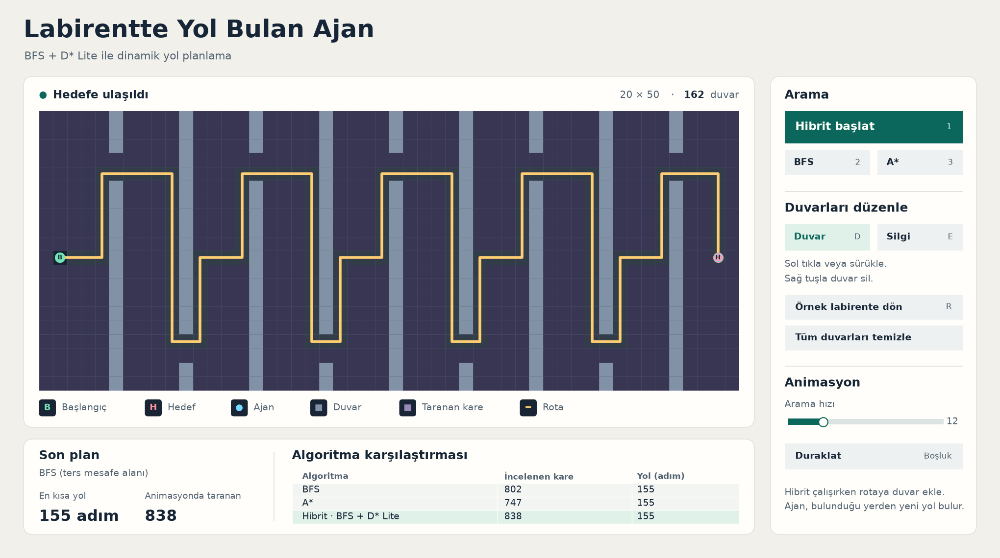
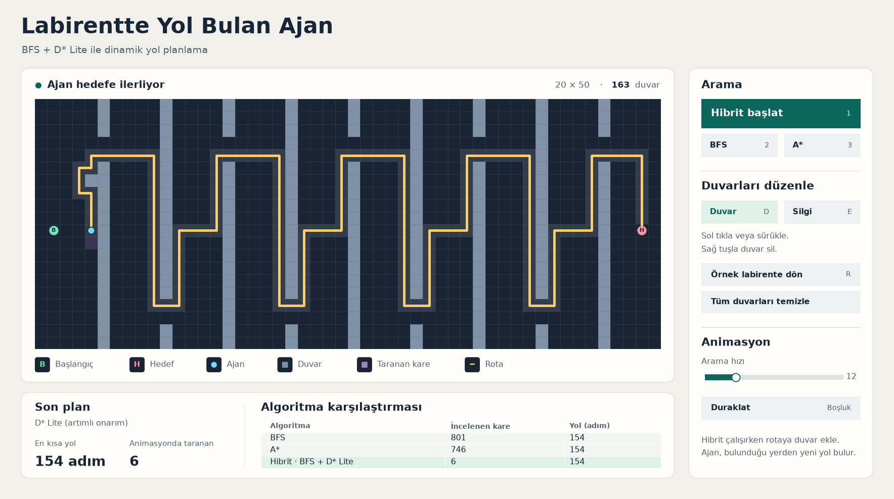

# Labirentte Yol Bulan Ajan

**Proje 3 · Python / Matplotlib · BFS + D* Lite · A* karşılaştırması**

20 × 50 karelik labirentte fareyle duvar ekleyebilir, aramayı izleyebilir ve ajanın izlediği en kısa yolu görebilirsiniz. Örnek haritada dokuz ayrı duvar şeridi bulunur. Hibrit aramada ters BFS ilk planı çıkarır. Ajan hareket ederken harita değişirse D* Lite rotayı ajanın bulunduğu kareden günceller.



## Çalıştırma

Python 3.10 veya üzeri gerekir. Reponun kökünde şu komutları çalıştırın.

```bash
cd labirent-ajan
python -m pip install -r requirements.txt
python main.py
```

**Hibrit başlat** düğmesine basın. Mavi ajan ilerlerken sarı rotanın önüne sol fareyle duvar ekleyin. Yeni rota çizildiğinde **Son plan** bölümünde **D* Lite (artımlı onarım)** görünür. Sağ fareyle duvar silebilirsiniz.



## Sonuçlar

| Örnek senaryo | En kısa yol | BFS | A* | Hibrit |
|---|---:|---:|---:|---:|
| İlk plan | 155 adım | 802 kare | 747 kare | 838 kare |
| Ajanın önüne duvar eklendi | 154 adım | 801 kare | 746 kare | 6 kare |

İlk planda A* ve BFS aynı uzunlukta yol buldu. A* 55 daha az kare işledi. Duvar eklendiğinde hibrit, önceki planın mesafe bilgilerini kullanarak 6 kareyi onardı. Sayılar her planda işlenen benzersiz kareleri gösterir.

- [Veri seti · 20 × 50 örnek labirent](labirent-ajan/data/maze.json)
- [Python kaynak kodları ve ayrıntılı kullanım](labirent-ajan/)
- [Tüm ölçümler](labirent-ajan/docs/results.csv)
